# PPS_Newapproach_V4: design notes

This document explains how [`PPS_Newapproach_V4.ino`](../ESP32/ESP32-Ethernet/PPS_Newapproach_V4/PPS_Newapproach_V4.ino) works. The sketch turns a WT32-ETH01 (ESP32 + LAN8720 Ethernet) and a GNSS receiver with a PPS output into a stratum 1 NTP server.

## Goals

The sketch is built around two goals:

1. **Low response latency.** Take the NTP receive timestamp as soon as the packet reaches the IP stack, and send the reply straight from there.
2. **Low jitter.** Keep the ESP32 system clock in step with GPS by slewing it (`adjtime`) for small errors. It only steps the clock (`settimeofday`) for large errors.

Everything else (OTA updates, the status LED, error recovery) supports those two goals.

## Hardware assumptions

The code assumes one hardware setup and has no runtime configuration:

| Item | Value |
| --- | --- |
| Board | WT32-ETH01 (ESP32, LAN8720 PHY, external 50 MHz clock on GPIO0) |
| GNSS receiver | Quescan M10050 (u-blox M10), default settings: 38400 baud NMEA, 1 Hz PPS |
| GPS UART RX / TX | GPIO15 / GPIO4 (UART1) |
| PPS input | GPIO2, rising edge |
| PHY power / MDC / MDIO | GPIO16 / GPIO23 / GPIO18, PHY address 1 |
| Status LED | GPIO33 (the board has no LED; this is a placeholder) |

The build-time settings are `#define`s at the top of the file:

| Setting | Meaning |
| --- | --- |
| `GPS_BAUD` | NMEA serial speed |
| `CORRECTION_US` | Fixed offset in µs added to every sync, tuned by measurement (see [Timing correction](#timing-correction-correction_us)) |
| `NTP_EPOCH_OFFSET` | Seconds between 1900-01-01 (NTP epoch) and 1970-01-01 (Unix epoch) |
| `NTP_PORT` | UDP 123 |

## Architecture overview

Four execution contexts share two pieces of state: the ESP32 system clock (`gettimeofday`) and a few `volatile` globals.

```mermaid
flowchart LR
    PPS[PPS pin<br/>rising edge] -->|ISR| LP[(lastPPSMicros)]
    UART[GPS UART<br/>NMEA] --> GT
    LP --> GT[gpsTask<br/>core 1, prio 2<br/>every 10 ms]
    GT -->|settimeofday / adjtime| CLK[(ESP32<br/>system clock)]
    GT --> REF[(lastSyncSec<br/>lastSyncFrac)]
    NET[Ethernet / lwIP] -->|udp_recv callback| CB[onNtpPacket<br/>tcpip thread]
    CLK --> CB
    REF --> CB
    CB -->|udp_sendto| NET
    LOOP[loop&#40;&#41;<br/>ArduinoOTA.handle] -.-> NET
```



| Context | Function | Job |
| --- | --- | --- |
| Interrupt | `PPS_ISR` | Saves `micros()` at each PPS rising edge |
| FreeRTOS task `GPS` | `gpsTask` → `readGPSTime` | Parses NMEA, lines up GPS time with the latest PPS edge, corrects the system clock |
| lwIP tcpip thread | `onNtpPacket` | Timestamps each NTP request and replies in place |
| Arduino `loop()` | `loop` | Handles OTA every 100 ms |

The clock is read and written only through the standard POSIX calls. The NTP path never touches the GPS or PPS data directly. It just reads the system clock, which `gpsTask` keeps disciplined.

## Startup sequence (`setup`)

1. **Fix the CPU at 240 MHz** so frequency scaling can't change timing behavior.
2. **Wait 10 s** so the GNSS module can power up before the UART is opened.
3. **Start GPS input.** Open UART1 at `GPS_BAUD` and attach `PPS_ISR` to the rising edge of GPIO2.
4. **`initNetwork()`.** Power-cycle the LAN8720 through `ETH_POWER_PIN`, start `ETH`, and wait up to 30 s for a DHCP address.
5. **`initOTA()`.** Start ArduinoOTA with hostname `gpsclock` (advertised over mDNS).
6. **`initRawNTP()`.** Register the raw lwIP UDP callback on port 123 (see below).
7. **Start `gpsTask`,** pinned to core 1 at priority 2, with a 4 KB stack.

If a step fails (PHY start, DHCP timeout, UDP PCB create/bind), `fatalError()` prints a message, waits 2 s, and calls `ESP.restart()`. The device keeps retrying through reboots instead of hanging.

## Clock discipline (`readGPSTime`)

`gpsTask` calls `readGPSTime()` every 10 ms. Each call does the following.

### 1. Snapshot the timing references first

```cpp
uint32_t localPPS  = lastPPSMicros;
uint32_t nowMicros = micros();
```

These two values are read before the UART is drained, so the PPS-to-now interval is measured as close to the start of the call as possible.

### 2. Feed NMEA into TinyGPSPlus

All pending UART bytes go into `gps.encode()`. The rest of the function runs only when a new, valid time has just been decoded (`gps.time.isUpdated() && gps.time.isValid()`).

### 3. Process each second only once

The receiver sends several sentences per second that carry the time (e.g. RMC and GGA). `previousSecond` makes sure only the first one for a given second is used.

### 4. Line up the NMEA time with its PPS edge

The design depends on how the receiver behaves: the PPS edge marks the exact start of a UTC second, and the NMEA sentences that name that second arrive a few hundred milliseconds later.

```
 PPS edge (second N)                       NMEA "N" parsed here
      |<---------------- delta ---------------->|
 -----+------------------------------------------+-----------+---- time
  lastPPSMicros                              nowMicros   next PPS (N+1)
```

`delta = nowMicros - localPPS` is the time elapsed since the start of second N, so the true time at `nowMicros` is `N + delta µs`. The unsigned subtraction stays correct when `micros()` wraps.

A guard throws away updates where `delta` is outside about **1 ms – 900 ms**:

- `delta > 900 ms`: the PPS stamp is probably from the previous second (a PPS edge was missed, or the NMEA arrived very late).
- `delta < 1 ms`: the PPS for second N+1 probably fired before the NMEA for second N was parsed, so the pairing would be wrong by one second.

### 5. Build the target time

The status LED toggles, so it blinks at 0.5 Hz while syncs are being accepted. The GPS date and time go into a `struct tm` and `mktime()` converts it to Unix seconds. This works because the ESP32's default time zone is UTC, so `mktime` effectively acts as `timegm`.

The target is `gpsSecs` seconds plus `delta + CORRECTION_US` microseconds. The code compares it with the current system clock to get an adjustment `adj` (seconds and microseconds, normalized so that `0 ≤ tv_usec < 1 000 000`).

### 6. Slew or step

```cpp
if (abs(adj.tv_sec) >= 1)  settimeofday(...);   // step: large error, e.g. first sync
else                       adjtime(&adj, NULL); // slew: small error, no time jump
```

- A **step** (`settimeofday`) jumps the clock straight to the target. This is what happens at first sync, when the clock is still near 1970.
- A **slew** (`adjtime`) asks the kernel to speed up or slow down the clock slightly until the error is gone. Time never jumps and never runs backwards, so NTP clients see smooth time and low jitter.

### 7. Publish the reference timestamp

`lastSyncSec` and `lastSyncFrac` are stored already in NTP format and network byte order. The NTP callback can then copy them into replies without converting.

## NTP server (`onNtpPacket`)

### Why the raw lwIP API

The usual Arduino approach is a `WiFiUDP`/`AsyncUDP` object polled from a task. That adds a variable delay between the packet arriving and the task being scheduled to timestamp it, and the variable part is jitter. This sketch registers a callback with lwIP's raw API instead:

```cpp
LOCK_TCPIP_CORE();
ntp_pcb = udp_new();
udp_bind(ntp_pcb, IP_ADDR_ANY, NTP_PORT);
udp_recv(ntp_pcb, onNtpPacket, NULL);
UNLOCK_TCPIP_CORE();
```

`onNtpPacket` runs directly in the lwIP tcpip thread as soon as the stack has demultiplexed the datagram. Raw-API calls made from outside that thread must hold the core lock, which is why `initRawNTP` wraps them in `LOCK_TCPIP_CORE` / `UNLOCK_TCPIP_CORE`.

### Request handling

1. **Timestamp first.** `gettimeofday()` is the first thing the callback does, before any validation.
2. **Check the size.** Anything shorter than 48 bytes (`sizeof(ntp_packet_t)`) is ignored.
3. **Edit the packet in place (zero copy).** The received `pbuf` payload is cast to `ntp_packet_t` and overwritten:

   | Field | Value |
   | --- | --- |
   | `li_vn_mode` | `0x24`: leap indicator 0, version 4, mode 4 (server) |
   | `stratum` | 1 (primary reference) |
   | `refId` | `"GPS\0"` |
   | `refTm` | last sync time from `lastSyncSec` / `lastSyncFrac` |
   | `origTm` | the client's transmit timestamp, copied from `txTm` |
   | `rxTm`, `txTm` | the timestamp from step 1 |

   The fraction field is `tv_usec × 2³² / 10⁶` (`4294.967296`).
4. **Reflect.** The same `pbuf` goes back to the sender with `udp_sendto`, then `pbuf_free` releases it.

Setting `rxTm` and `txTm` to the same value assumes the processing time is negligible, which is reasonable because the callback does almost no work.

## Timing correction (`CORRECTION_US`)

`CORRECTION_US` (currently 545 µs) is an empirical constant added to `delta` on every sync. It absorbs fixed latencies that the code doesn't measure, mainly:

- interrupt latency between the PPS edge and `micros()` in the ISR;
- the time between capturing `nowMicros` and calling `gettimeofday()` in `readGPSTime` (UART draining, NMEA parsing, `mktime`);
- any fixed offset in the receiver's PPS output or the measurement setup.

It is tuned by comparing the server against a trusted reference (see the testing notes in the [README](../README.md)), and will probably need re-tuning for a different board, receiver, or library version.

## OTA updates

ArduinoOTA runs from `loop()` with hostname `gpsclock`. When an update starts, the PPS interrupt is detached so the ISR (in IRAM) can't interfere with flash writes. If an update fails, the device restarts.

## Shared state and concurrency

| Variable | Writer | Reader(s) |
| --- | --- | --- |
| `lastPPSMicros` | `PPS_ISR` | `gpsTask` |
| `lastSyncSec`, `lastSyncFrac` | `gpsTask` | `onNtpPacket` |
| System clock | `gpsTask` (`settimeofday`/`adjtime`) | `onNtpPacket` (`gettimeofday`) |

Each variable is a single aligned 32-bit word, so each read or write is atomic on the ESP32. `volatile` stops the compiler from caching them. There are no locks. The worst case is a reply whose `refTm` mixes the seconds of one sync with the fraction of another. Clients don't use `refTm` to calculate offsets, so this is harmless in practice.

## Known limitations and observations

These come from reading the code, not from testing.

- **The server always claims to be synchronized.** Replies always carry stratum 1 and leap indicator 0, even before the first GPS sync or after losing GPS. Clients have no way to tell that the server has drifted.
- **Some header fields are echoed back from the request.** `poll`, `precision`, `rootDelay` and `rootDispersion` are left as the client sent them instead of being set by the server.
- **Only clock-behind errors are slewed.** After normalization `adj.tv_usec` is always non-negative, so if the system clock is *ahead* of GPS by any amount (even 1 µs), `adj.tv_sec` becomes −1 and the code steps the clock instead of slewing. In practice the clock is slewed when it is behind and stepped when it is ahead. A check on the total offset (e.g. `|adj.tv_sec × 10⁶ + adj.tv_usec| ≥ 10⁶`) would slew in both directions.
- **Comment and code disagree on the lower guard.** The comment in the delta guard says "< 10ms", but the code uses `delta < 1000` (1 ms).
- **Possible stale date at midnight.** The date comes from the most recent RMC sentence. If a GGA sentence for 00:00:00 is decoded before the RMC for the new day, the date can be a day behind for that one sync. `gps.date.isValid()` is also not checked.
- **Variable processing time before `gettimeofday`.** The time spent draining and parsing the UART between `nowMicros` and `gettimeofday()` varies with how many bytes are waiting. `CORRECTION_US` only removes the average, so the rest shows up as jitter.
- **No holdover or fix-quality checks.** Any valid NMEA time paired with a PPS edge is trusted. Satellite count and fix status are not checked.
- **Hard-coded OTA password.** The OTA password (`uploadota`) is in the source.
- **No watchdog** (listed as a TODO in the README).
- **Unused leftovers.** The commented-out `firstUpdate` logic (only adjusting at :00/:30) is from an earlier approach. `credentials.h` sits in the sketch folder but is not included.
- **Year 2036.** NTP seconds are 32-bit (`tv_sec + NTP_EPOCH_OFFSET`), so they wrap in February 2036 (NTP era 1). Most clients handle this, but it is worth knowing.
