# PPS_Newapproach_V4: design notes

This document explains how [`PPS_Newapproach_V4.ino`](../ESP32/ESP32-Ethernet/PPS_Newapproach_V4/PPS_Newapproach_V4.ino) works. The sketch turns a WT32-ETH01 (ESP32 + LAN8720 Ethernet) and a GNSS receiver with a PPS output into a stratum 1 NTP server.

## Goals

The sketch is built around two goals:

1. **Low response latency.** Take the NTP receive timestamp as soon as the packet reaches the IP stack, and send the reply straight from there.
2. **Low jitter.** Keep the ESP32 system clock in step with GPS by slewing it (`adjtime`) for small errors. It only steps the clock (`settimeofday`) for large errors.

Everything else (OTA updates, the status LED, error recovery) supports those two goals.

## Hardware assumptions

The code assumes one hardware setup and has no runtime configuration:

| Item | Value |
| --- | --- |
| Board | WT32-ETH01 (ESP32, LAN8720 PHY, external 50 MHz clock on GPIO0) |
| GNSS receiver | Quescan M10050 (u-blox M10), default settings: 38400 baud NMEA, 1 Hz PPS |
| GPS UART RX / TX | GPIO15 / GPIO4 (UART1) |
| PPS input | GPIO2, rising edge |
| PHY power / MDC / MDIO | GPIO16 / GPIO23 / GPIO18, PHY address 1 |
| Status LED | GPIO33 (the board has no LED; this is a placeholder) |

The build-time settings are `#define`s at the top of the file:

| Setting | Meaning |
| --- | --- |
| `GPS_BAUD` | NMEA serial speed |
| `CORRECTION_US` | Fixed offset in µs added to every sync, tuned by measurement (see [Timing correction](#timing-correction-correction_us)) |
| `NTP_EPOCH_OFFSET` | Seconds between 1900-01-01 (NTP epoch) and 1970-01-01 (Unix epoch) |
| `NTP_PORT` | UDP 123 |
| `HOLDOVER_MS` | How long (60 s) the server keeps reporting itself as synchronized after the last accepted GNSS sync (see [Request handling](#request-handling)) |

## Architecture overview

Four execution contexts share two pieces of state: the ESP32 system clock (`gettimeofday`) and a few `volatile` globals.

```mermaid
flowchart LR
    PPS[PPS pin<br/>rising edge] -->|ISR| LP[(lastPPSMicros)]
    UART[GPS UART<br/>NMEA] --> GT
    LP --> GT[gpsTask<br/>core 1, prio 2<br/>every 10 ms]
    GT -->|settimeofday / adjtime| CLK[(ESP32<br/>system clock)]
    GT --> REF[(lastSyncSec<br/>lastSyncFrac<br/>lastSyncMillis<br/>everSynced)]
    NET[Ethernet / lwIP] -->|udp_recv callback| CB[onNtpPacket<br/>tcpip thread]
    CLK --> CB
    REF --> CB
    CB -->|udp_sendto| NET
    LOOP[loop&#40;&#41;<br/>ArduinoOTA.handle] -.-> NET
```



| Context | Function | Job |
| --- | --- | --- |
| Interrupt | `PPS_ISR` | Saves `micros()` at each PPS rising edge |
| FreeRTOS task `GPS` | `gpsTask` → `readGPSTime` | Parses NMEA, lines up GPS time with the latest PPS edge, corrects the system clock |
| lwIP tcpip thread | `onNtpPacket` | Timestamps each NTP request and replies in place |
| Arduino `loop()` | `loop` | Handles OTA every 100 ms |

The clock is read and written only through the standard POSIX calls. The NTP path never touches the GPS or PPS data directly. It just reads the system clock, which `gpsTask` keeps disciplined.

## Startup sequence (`setup`)

1. **Fix the CPU at 240 MHz** so frequency scaling can't change timing behavior.
2. **Wait 10 s** so the GNSS module can power up before the UART is opened.
3. **Start GPS input.** Open UART1 at `GPS_BAUD` and attach `PPS_ISR` to the rising edge of GPIO2.
4. **`initNetwork()`.** Power-cycle the LAN8720 through `ETH_POWER_PIN`, start `ETH`, and wait up to 30 s for a DHCP address.
5. **`initOTA()`.** Start ArduinoOTA with hostname `gpsclock`. mDNS is disabled, so upload by IP.
6. **`initRawNTP()`.** Register the raw lwIP UDP callback on port 123 (see below).
7. **Start `gpsTask`,** pinned to core 1 at priority 2, with a 4 KB stack.

If a step fails (PHY start, DHCP timeout, UDP PCB create/bind), `fatalError()` prints a message, waits 2 s, and calls `ESP.restart()`. The device keeps retrying through reboots instead of hanging.

## Clock discipline (`readGPSTime`)

`gpsTask` calls `readGPSTime()` every 10 ms. Each call does the following.

### 1. Snapshot the timing references first

```cpp
uint32_t localPPS  = lastPPSMicros;
uint32_t nowMicros = micros();
```

`localPPS` is captured before the UART is drained, so a PPS edge that fires during parsing can't replace the edge for the second being decoded. `nowMicros` is used only for the pairing check in step 4. The offset itself is measured later, in step 5.

### 2. Feed NMEA into TinyGPSPlus

All pending UART bytes go into `gps.encode()`. The rest of the function runs only when a new, valid time has just been decoded (`gps.time.isUpdated() && gps.time.isValid()`).

### 3. Process each second only once

The receiver sends several sentences per second that carry the time (e.g. RMC and GGA). `previousSecond` makes sure only the first one for a given second is used.

### 4. Line up the NMEA time with its PPS edge

The design depends on how the receiver behaves: the PPS edge marks the exact start of a UTC second, and the NMEA sentences that name that second arrive a few hundred milliseconds later.

```
 PPS edge (second N)                       NMEA "N" parsed here
      |<---------------- delta ---------------->|
 -----+------------------------------------------+-----------+---- time
  lastPPSMicros                              nowMicros   next PPS (N+1)
```

`delta = nowMicros - localPPS` is the time elapsed since the start of second N, so the true time at `nowMicros` is `N + delta µs`. The unsigned subtraction stays correct when `micros()` wraps.

A guard throws away updates where `delta` is outside about **1 ms – 900 ms**:

- `delta > 900 ms`: the PPS stamp is probably from the previous second (a PPS edge was missed, or the NMEA arrived very late).
- `delta < 1 ms`: the PPS for second N+1 probably fired before the NMEA for second N was parsed, so the pairing would be wrong by one second.

### 5. Build the target time

The status LED toggles, so it blinks at 0.5 Hz while syncs are being accepted. The GPS date and time go into a `struct tm` and `mktime()` converts it to Unix seconds. This works because the ESP32's default time zone is UTC, so `mktime` effectively acts as `timegm`.

To compare GNSS time with the system clock, the code needs both clocks read at the same instant. It reads `micros()`, `gettimeofday()`, then `micros()` again back to back, and uses the midpoint of the two `micros()` reads. If the pair is more than 20 µs apart (the task was preempted in between), it retries, up to 5 times:

```cpp
uint32_t sinceEdge = (m0 + (m1 - m0) / 2) - localPPS;   // µs since PPS edge N when 'now' was read
int64_t offset_us = (int64_t)(gpsSecs - now.tv_sec) * 1000000LL
                  + ((int64_t)sinceEdge + CORRECTION_US - now.tv_usec);
```

The target is `gpsSecs` seconds plus `sinceEdge + CORRECTION_US` microseconds, taken at the moment `now` was read. Because both readings come from the same moment, the time spent draining the UART, parsing NMEA and in `mktime()` doesn't end up in the offset. Before this change, `delta` (from step 1) was compared with a `gettimeofday()` taken after parsing. That gap varied from second to second and went straight into the clock as jitter.

`offset_us` is GNSS time minus system time. It is positive when the system clock is behind and negative when it is ahead.

### 6. Slew or step

```cpp
if (llabs(offset_us) >= 1000000) settimeofday(...);   // step: error of 1 s or more, e.g. first sync
else                             adjtime(&adj, NULL); // slew: adj.tv_usec = offset_us, adj.tv_sec = 0
```

- A **step** (`settimeofday`) jumps the clock straight to the target. This is what happens at first sync, when the clock is still near 1970.
- A **slew** (`adjtime`) asks the C library to run the clock slightly fast (positive offset) or slightly slow (negative offset) until the error is gone. Because `|offset_us| < 1 s`, it fits in `tv_usec` with `tv_sec = 0`. Time never jumps and never runs backwards, so NTP clients see smooth time and low jitter.

The same threshold applies in both directions: a clock that is ahead is slewed back just like one that is behind.

### 7. Publish the sync state

- `lastSyncSec` and `lastSyncFrac` hold the reference timestamp, stored already in NTP format and network byte order. The NTP callback can then copy them into replies without converting.
- `lastSyncMillis` records `millis()` at this sync. The NTP callback uses it to decide whether GNSS has been lost for too long.
- `everSynced` is set to `true`. Until then the NTP callback doesn't answer any request.

## NTP server (`onNtpPacket`)

### Why the raw lwIP API

The usual Arduino approach is a `WiFiUDP`/`AsyncUDP` object polled from a task. That adds a variable delay between the packet arriving and the task being scheduled to timestamp it, and the variable part is jitter. This sketch registers a callback with lwIP's raw API instead:

```cpp
LOCK_TCPIP_CORE();
ntp_pcb = udp_new();
udp_bind(ntp_pcb, IP_ADDR_ANY, NTP_PORT);
udp_recv(ntp_pcb, onNtpPacket, NULL);
UNLOCK_TCPIP_CORE();
```

`onNtpPacket` runs directly in the lwIP tcpip thread as soon as the stack has demultiplexed the datagram. Raw-API calls made from outside that thread must hold the core lock, which is why `initRawNTP` wraps them in `LOCK_TCPIP_CORE` / `UNLOCK_TCPIP_CORE`.

### Request handling

1. **Timestamp first.** `gettimeofday()` is the first thing the callback does, before any validation.
2. **Decide whether to answer.** The packet is dropped without a reply unless all of these hold:
   - `everSynced` is true, so the server never hands out the 1970 boot time;
   - it is at least 48 bytes (`sizeof(ntp_packet_t)`);
   - its mode is 3 (client), so the server never answers another server's reply.
3. **Check freshness.** The reply counts as *stale* when `millis() - lastSyncMillis > HOLDOVER_MS`, that is, when no GNSS sync has been accepted for more than 60 s. Unsigned subtraction keeps this correct when `millis()` wraps.
4. **Edit the packet in place (zero copy).** The received `pbuf` payload is cast to `ntp_packet_t` and overwritten:

   | Field | Value |
   | --- | --- |
   | `li_vn_mode` | Leap indicator 0 when fresh or 3 (unsynchronized) when stale, version copied from the request, mode 4 (server) |
   | `stratum` | 1 (primary reference) when fresh, 16 (unsynchronized) when stale |
   | `refId` | `"GPS\0"` |
   | `refTm` | last sync time from `lastSyncSec` / `lastSyncFrac` |
   | `origTm` | the client's transmit timestamp, copied from `txTm` |
   | `rxTm` | the timestamp from step 1 |

   The fraction field is `tv_usec × 2³² / 10⁶`, computed by `usecToNtpFrac()` with a 64-bit integer multiply and shift (`usec × 281474977 >> 16`, within about 1 ns of exact). The ESP32's FPU is single-precision only, so `double` maths would be emulated in software.
5. **Transmit timestamp last.** `gettimeofday()` is called again and written to `txTm` just before sending. The client computes delay as `(T4 − T1) − (T3 − T2)`, so the server's processing time is subtracted instead of being counted as network delay.
6. **Reflect.** The same `pbuf` goes back to the sender with `udp_sendto`, then `pbuf_free` releases it.

A stale server keeps answering. It still serves its free-running clock, but LI=3 and stratum 16 tell clients not to trust it. Clients such as chrony and ntpd will then ignore it. As soon as a new sync is accepted, replies go back to LI=0 and stratum 1.

## Timing correction (`CORRECTION_US`)

`CORRECTION_US` (currently 545 µs) is an empirical constant added to `delta` on every sync. It absorbs fixed latencies that the code doesn't measure, mainly:

- interrupt latency between the PPS edge and `micros()` in the ISR;
- the time from the Ethernet frame arriving to the `gettimeofday()` call in `onNtpPacket`, and from the final `gettimeofday()` to the reply leaving;
- any fixed offset in the receiver's PPS output or the measurement setup.

It is tuned by measuring the server over NTP against a trusted reference (see [Tuning](#tuning)). Because it is measured the way clients see the server, it also cancels any fixed bias in the network path. It will probably need re-tuning for a different board, receiver, cable, switch, or core/library version.

The 545 µs value was tuned before the back-to-back clock sampling in `readGPSTime` was added. At that time it also absorbed the average UART parsing time, so it needs re-tuning and will probably come down by a few hundred µs.

### Tuning

1. **Set up a reference.** Use a machine disciplined by its own GNSS PPS, such as the Raspberry Pi + chrony setup in [`Raspberry Pi/`](../Raspberry%20Pi/), on the same switch as the ESP32. An internet NTP source is only accurate to about a millisecond, which is too coarse.
2. **Monitor the ESP32 from the reference.** Add this to the reference's `chrony.conf`:

   ```
   server <esp32-ip> iburst noselect minpoll 2 maxpoll 2
   ```

   `noselect` lets chrony measure the ESP32 without letting it steer the reference's clock. Polling every 4 s fills chrony's 64-sample window in about 4 minutes.
3. **Measure.** After each upload, wait about 10 minutes for the initial step and slews to settle. Then read the ESP32's `Offset` and `Std Dev` from `chronyc sourcestats`, a few times a minute or two apart.
4. **Adjust.** In chrony, a positive offset means the reference is ahead of the ESP32, so the ESP32 is behind.
   - Offset of +X µs: increase `CORRECTION_US` by X.
   - Offset of −X µs: decrease it by X.

   If the next measurement's offset grows instead of shrinking, the sign is the wrong way round: undo the change and go the other way.
5. **Stop when the offset is smaller than the `Std Dev`.** Below that you're tuning to noise. For a longer average that ignores outliers, add `log measurements` to `chrony.conf` and take the median offset from `/var/log/chrony/measurements.log` over 30 minutes or more.

## OTA updates

ArduinoOTA runs from `loop()` with hostname `gpsclock`. Its mDNS responder is turned off (`setMdnsEnabled(false)`), because mDNS traffic is handled in the same lwIP tcpip thread as the NTP callback and could delay it. Uploads must therefore use the device's IP address. When an update starts, the PPS interrupt is detached so the ISR (in IRAM) can't interfere with flash writes. If an update fails, the device restarts.

## Shared state and concurrency

| Variable | Writer | Reader(s) |
| --- | --- | --- |
| `lastPPSMicros` | `PPS_ISR` | `gpsTask` |
| `lastSyncSec`, `lastSyncFrac` | `gpsTask` | `onNtpPacket` |
| `lastSyncMillis`, `everSynced` | `gpsTask` | `onNtpPacket` |
| System clock | `gpsTask` (`settimeofday`/`adjtime`) | `onNtpPacket` (`gettimeofday`) |

Each variable is a single aligned word (32-bit, or a `bool`), so each read or write is atomic on the ESP32. `volatile` stops the compiler from caching them. There are no locks. The worst case is a reply whose `refTm` mixes the seconds of one sync with the fraction of another. Clients don't use `refTm` to calculate offsets, so this is harmless in practice.

## Known limitations and observations

These come from reading the code, not from testing.

- **Some header fields are echoed back from the request.** `poll`, `precision`, `rootDelay` and `rootDispersion` are left as the client sent them instead of being set by the server. Root dispersion in particular doesn't grow during holdover, so for the first 60 s after GNSS is lost, clients can't see that the clock is getting less accurate.
- **A new slew is requested every second.** `adjtime` is called on every accepted sync (the earlier "only adjust every N seconds" gate is commented out). Each call replaces any adjustment still in progress, so a correction that takes longer than a second to slew in is never completed as asked. Instead it is re-measured and re-requested the next second.
- **Comment and code disagree on the lower guard.** The comment in the delta guard says "< 10ms", but the code uses `delta < 1000` (1 ms).
- **Possible stale date at midnight.** The date comes from the most recent RMC sentence. If a GGA sentence for 00:00:00 is decoded before the RMC for the new day, the date can be a day behind for that one sync. `gps.date.isValid()` is also not checked.
- **Phase-only correction.** Each sync corrects the clock's offset but not its rate. The crystal's frequency error (typically ±10–20 ppm) therefore builds up to roughly 10–20 µs between corrections, a sawtooth pattern.
- **PPS interrupt latency.** The PPS edge is timestamped by a level-1 Arduino `attachInterrupt` handler, which other level-1 interrupts on the same core (such as the GPS UART) can delay.
- **No fix-quality checks.** Any valid NMEA time paired with a PPS edge is trusted. Satellite count and fix status are not checked. The holdover limit only reacts when syncs *stop*, not when they come from a poor fix.
- **Holdover is a fixed timeout.** The server is reported as synchronized for the full `HOLDOVER_MS` after the last sync, however much the clock actually drifts in that time.
- **Hard-coded OTA password.** The OTA password (`uploadota`) is in the source.
- **No watchdog** (listed as a TODO in the README).
- **Unused leftovers.** The commented-out `firstUpdate` logic (only adjusting at :00/:30) is from an earlier approach. `credentials.h` sits in the sketch folder but is not included.
- **Year 2036.** NTP seconds are 32-bit (`tv_sec + NTP_EPOCH_OFFSET`), so they wrap in February 2036 (NTP era 1). Most clients handle this, but it is worth knowing.
