# PPS_Newapproach_V4: design notes

This document explains how [`PPS_Newapproach_V4.ino`](../ESP32/ESP32-Ethernet/PPS_Newapproach_V4/PPS_Newapproach_V4.ino) works. The sketch turns a WT32-ETH01 (ESP32 + LAN8720 Ethernet) and a GNSS receiver with a PPS output into a stratum 1 NTP server.

## Goals

The sketch is built around two goals:

1. **Low response latency.** Take the NTP receive timestamp as soon as the packet reaches the IP stack, and send the reply straight from there.
2. **Low jitter.** Serve time from the ESP32's free-running microsecond timer (`esp_timer`), anchored at the latest PPS edge and corrected for the timer's measured frequency error. The ESP32 system clock (`gettimeofday`, `adjtime`) isn't used at all.

Everything else (OTA updates, the status LED, error recovery) supports those two goals.

## Hardware assumptions

The code assumes one hardware setup and has no runtime configuration:

| Item | Value |
| --- | --- |
| Board | WT32-ETH01 (ESP32, LAN8720 PHY, external 50 MHz clock on GPIO0) |
| GNSS receiver | Quescan M10050 (u-blox M10), default settings: 38400 baud NMEA, 1 Hz PPS |
| GPS UART RX / TX | GPIO15 / GPIO4 (UART1) |
| PPS input | GPIO2, rising edge |
| PHY power / MDC / MDIO | GPIO16 / GPIO23 / GPIO18, PHY address 1 |
| Status LED | GPIO33 (the board has no LED; this is a placeholder) |

The build-time settings are `#define`s at the top of the file:

| Setting | Meaning |
| --- | --- |
| `GPS_BAUD` | NMEA serial speed |
| `CORRECTION_US` | Fixed latency in µs between the true PPS edge and its timestamp, tuned by measurement (see [Timing correction](#timing-correction-correction_us)) |
| `NTP_EPOCH_OFFSET` | Seconds between 1900-01-01 (NTP epoch) and 1970-01-01 (Unix epoch) |
| `NTP_PORT` | UDP 123 |
| `HOLDOVER_MS` | How long (60 s) the server keeps reporting itself as synchronized after the last accepted GNSS sync (see [Request handling](#request-handling)) |
| `MAX_PPM` | PPS edges whose spacing implies a clock error above this (100 ppm) are rejected as glitches (see [Sanity-check the edge](#6-sanity-check-the-edge)) |
| `MAX_EDGE_JITTER_US` | Base tolerance (15 µs) for a PPS edge's residual against the rate-predicted spacing once locked |
| `MAX_DRIFT_PPM` | Per-second tolerance (5 ppm) added to `MAX_EDGE_JITTER_US` to allow temperature drift across GNSS outages |
| `MIN_SATS` | Minimum satellites in use (4, from GGA) required to accept a GNSS sync |
| `MIN_VALID_YEAR` | Reject uninitialized/RTC-default GNSS dates before this year (2025) |
| `RATE_SHIFT` | How strongly the frequency estimate is smoothed: it averages over about 2^`RATE_SHIFT` (16) syncs |
| `NTP_PRECISION` | Reported clock precision in log2 seconds (`-20`, ≈ 0.95 µs, matching `esp_timer`'s 1 µs resolution) |
| `ROOT_DISP_BASE_US` | Baseline root dispersion in µs when freshly synced (50 µs) |
| `ROOT_DISP_PPM` | Rate at which reported root dispersion grows with anchor age (15 ppm, matching RFC 5905 `PHI`) |

## Architecture overview

Four execution contexts share two main pieces of state: the MCPWM capture timestamps (`lastPPSCap` / `lastPPSRoughUs`), and the `timescale` struct protected by the `tsMux` spinlock.

```mermaid
flowchart LR
    PPS[PPS pin<br/>rising edge] -->|MCPWM hw capture<br/>80 MHz| LP[(lastPPSCap<br/>lastPPSRoughUs)]
    UART[GPS UART<br/>NMEA / UBX] --> GT
    LP --> GT[gpsTask<br/>core 1, prio 2<br/>every 10 ms, TWDT]
    GT -->|updateTimescale| TS[(timescale<br/>edge, second, rate<br/>under tsMux)]
    TIMER[(esp_timer)] --> CB
    NET[Ethernet / lwIP] -->|udp_recv callback| CB[onNtpPacket<br/>tcpip thread]
    TS --> CB
    CB -->|udp_sendto| NET
    LOOP[loop&#40;&#41;<br/>ArduinoOTA.handle] -.-> NET
```



| Context | Function | Job |
| --- | --- | --- |
| Interrupt | `onPpsCapture` / `onSoftCapture` | Saves the 80 MHz MCPWM hardware-latched PPS counter value (`lastPPSCap`) and a coarse `esp_timer` stamp (`lastPPSRoughUs`), plus software-catch values for clock correlation |
| FreeRTOS task `GPS` | `gpsTask` → `readGPSTime` → `updateTimescale` | Feeds the task watchdog, parses NMEA RMC/GGA, maps the hardware PPS count into `esp_timer` microseconds via `snapshotClocks()`, validates the edge, updates the frequency estimate and publishes the new anchor |
| lwIP tcpip thread | `onNtpPacket` | Reads `esp_timer`, converts it to NTP time with `toNtp()`, and replies in place |
| Arduino `loop()` | `loop` | Handles OTA every 100 ms |

The served time is a pure function of an `esp_timer` reading and the published `timescale`:

```
time(t) = ntpSec + (t − edgeUs) × (1 − rate)
```

Here `edgeUs` is the `esp_timer` time of the last accepted PPS edge (shifted by `CORRECTION_US`), `ntpSec` is the UTC second that edge started, and `rate` is the timer's fractional frequency error. Nothing ever steps or slews a clock. Each new PPS edge simply replaces the anchor. Between anchors, and in holdover, time is extrapolated at the learned rate.

## Startup sequence (`setup`)

1. **Fix the CPU at 240 MHz** so frequency scaling can't change timing behavior.
2. **Wait 10 s** so the GNSS module can power up before the UART is opened.
3. **Start GPS input and hardware PPS capture.** Open UART1 at `GPS_BAUD`, call `initUbloxM10()` to send a RAM-only `UBX-CFG-VALSET` (Stationary dynamic model, keep only RMC + GGA NMEA sentences, and emit 1 Hz / 100 ms TP1 pulses only when GNSS-locked), and call `initPpsCapture()` to configure MCPWM0 channel 0 (rising-edge hardware capture on GPIO2 at 80 MHz) and channel 1 (software-only catch channel for `esp_timer` correlation).
4. **`initNetwork()`.** Power-cycle the LAN8720 through `ETH_POWER_PIN`, start `ETH`, and wait up to 30 s for a DHCP address.
5. **`initOTA()`.** Start ArduinoOTA with hostname `gpsclock`. mDNS is disabled, so upload by IP.
6. **`initRawNTP()`.** Register the raw lwIP UDP callback on port 123 (see below).
7. **Start `gpsTask`,** pinned to core 1 at priority 2, with a 4 KB stack; `gpsTask` subscribes itself to the ESP-IDF task watchdog (`esp_task_wdt_add(NULL)`).

If a step fails (PHY start, DHCP timeout, UDP PCB create/bind), `fatalError()` prints a message, waits 2 s, and calls `ESP.restart()`. The device keeps retrying through reboots instead of hanging.

The server stays silent until two consecutive GNSS syncs agree, typically 2–3 s after the receiver has a fix.

## Timescale (`readGPSTime`, `updateTimescale`)

`gpsTask` calls `readGPSTime()` every 10 ms. Each call does the following.

### 1. Snapshot the timing references first

Before draining the UART, `readGPSTime()` snapshots `havePPSCap`, `lastPPSCap` (the 80 MHz MCPWM hardware-latched rising-edge counter value), `lastPPSRoughUs` (a coarse `esp_timer` stamp taken in `onPpsCapture`), and `preDrainUs = esp_timer_get_time()`. If `lastPPSCap` changed between reads, it re-reads once for a consistent pair. Capturing these before draining the UART prevents a PPS edge that fires during parsing from replacing the edge for the second being decoded.

### 2. Feed NMEA into TinyGPSPlus and validate the fix

All pending UART bytes go into `gps.encode()`. Two `TinyGPSCustom` watchers inspect field 2 (the `A`/`V` fix-status flag) of `$GNRMC` and `$GPRMC`. The rest of the function runs only when:

- an RMC sentence (`$GNRMC` or `$GPRMC`) has just been decoded with status `'A'` (active fix), so date, time and fix status all come atomically from the same sentence;
- `gps.date.isValid()`, `gps.time.isValid()` and `gps.date.year() >= MIN_VALID_YEAR` hold (preventing cold-start or RTC-default dates from being accepted);
- `gps.satellites` (from GGA) is valid, fresh (`age() <= 2500` ms) and reports at least `MIN_SATS` (4) satellites in use.

### 3. Process each second only once

Only RMC sentences trigger updates, and `previousSecond` guards against reprocessing the same second.

### 4. Line up the NMEA time with its PPS edge

The design depends on how the receiver behaves: the PPS edge marks the exact start of a UTC second, and the NMEA sentences that name that second arrive a few hundred milliseconds later.

```
 PPS edge (second N)                       NMEA "N" parsed here
      |<--------------- deltaUs --------------->|
 -----+------------------------------------------+-----------+---- time
  lastPPSCap (hw 80 MHz)                    snapshotClocks()  next PPS (N+1)
```

Once a valid RMC sentence is decoded, `preDelta = (uint32_t)preDrainUs - localPPSRoughUs` is checked against **1 ms – 900 ms**. Then `snapshotClocks()` brackets a software catch on MCPWM channel 1 (`mcpwm_capture_channel_trigger_soft_catch`) between two `esp_timer_get_time()` reads inside a brief critical section (`capMux`), yielding a correlated `(nowUs, nowCap)` pair within ~1–2 µs.

`deltaTicks = nowCap - localPPSCap` is converted to `deltaUs` using `capResHz` (80 MHz, matching `esp_timer`'s APB clock source so there is zero clock-domain drift). Because the 32-bit 80 MHz counter wraps every 53.7 s, `deltaUs` is cross-checked against `roughDelta = (uint32_t)nowUs - localPPSRoughUs` (71.6 min wrap) and rejected if they disagree by more than 5 ms or fall outside **1 ms – 900 ms**:

- `delta > 900 ms`: the PPS stamp is probably from the previous second (a PPS edge was missed, or the NMEA arrived very late).
- `delta < 1 ms`: the PPS for second N+1 probably fired before the NMEA for second N was parsed, so the pairing would be wrong by one second.

### 5. Build the anchor

The status LED toggles, so it blinks at 0.5 Hz while syncs are being paired. The GPS date and time go into a `struct tm` and `mktime()` converts it to Unix seconds. This works because the ESP32's default time zone is UTC, so `mktime` effectively acts as `timegm`.

The anchor is the pair (NTP second N, full `esp_timer` time of edge N = `nowUs − delta`), passed to `updateTimescale()`. Parsing time doesn't matter here: the edge was timestamped by the ISR, and the parsing only labels it.

### 6. Sanity-check the edge

`updateTimescale()` compares the new anchor with the previous accepted one, which was `secs` seconds earlier. Over `secs` seconds, `esp_timer` should have advanced by `secs × 10⁶` µs, give or take the crystal's error. The difference, `gainUs`, is how far the timer ran ahead. The anchor is rejected if:

- `secs ≤ 0`: the label went backwards or didn't move;
- `|gainUs| > secs × MAX_PPM`: no real crystal is that far off, so either the PPS line glitched or the NMEA was paired with the wrong edge; or
- once `haveRate` is established, `|gainUs − expectedGainUs| > MAX_EDGE_JITTER_US + secs × MAX_DRIFT_PPM`: the edge deviated too far from the rate-predicted spacing (e.g., a delayed PPS ISR), while still allowing up to `MAX_DRIFT_PPM` of temperature drift across longer GNSS outages.

A rejected anchor isn't published, so replies keep being computed from the previous one. If three anchors in a row are rejected, the previous anchor (or learned rate) is assumed to be the bad one: `prevEdgeUs`/`prevSec` are re-seeded to the new candidate and `haveRate` is reset to `false`, **without publishing** to `timescale`. The following sync must corroborate the new candidate before clients ever see it.

### 7. Learn the frequency

For each accepted anchor, the frequency error over the interval is `gainUs / (secs × 10⁶)`, stored as a fraction × 2³² (`rateQ32`; 1 ppm ≈ 4295). The first sample is taken as is, and later ones go into an exponential average:

```cpp
rateQ32 += (sample − rateQ32) >> RATE_SHIFT;
```

A single 1 s interval is only accurate to the ISR jitter (about 1–2 ppm). Averaging over about 16 syncs brings that down to a fraction of a ppm, while still following temperature drift within tens of seconds. After a GNSS outage, the first interval spans the whole gap, so that sample is very accurate.

### 8. Publish

`edgeUs − CORRECTION_US`, `ntpSec`, `rateQ32` and `valid` are written to `timescale` under `portENTER_CRITICAL(&tsMux)`. `valid` stays false until the first accepted interval, that is, until two syncs agree. This means a glitched first edge is never served.

## NTP server (`onNtpPacket`)

### Why the raw lwIP API

The usual Arduino approach is a `WiFiUDP`/`AsyncUDP` object polled from a task. That adds a variable delay between the packet arriving and the task being scheduled to timestamp it, and the variable part is jitter. This sketch registers a callback with lwIP's raw API instead:

```cpp
LOCK_TCPIP_CORE();
ntp_pcb = udp_new();
udp_bind(ntp_pcb, IP_ADDR_ANY, NTP_PORT);
udp_recv(ntp_pcb, onNtpPacket, NULL);
UNLOCK_TCPIP_CORE();
```

`onNtpPacket` runs directly in the lwIP tcpip thread as soon as the stack has demultiplexed the datagram. Raw-API calls made from outside that thread must hold the core lock, which is why `initRawNTP` wraps them in `LOCK_TCPIP_CORE` / `UNLOCK_TCPIP_CORE`.

### Request handling

1. **Timestamp first.** `esp_timer_get_time()` is the first thing the callback does, before any validation. It takes no lock, unlike `gettimeofday()`, which takes a mutex inside ESP-IDF.
2. **Copy the timescale.** The callback copies `timescale` under `tsMux`. The spinlock is held only for the copy of a few words.
3. **Decide whether to answer.** The packet is dropped without a reply unless all of these hold:
   - `ts.valid` is true, so the server never hands out the boot time or a glitched edge;
   - the first `pbuf` segment is at least 48 bytes (`p->len >= sizeof(ntp_packet_t)`), so the NTP header is contiguous in memory;
   - its mode is 3 (client), so the server never answers another server's reply.

   If `p->tot_len` is larger than 48 bytes (e.g. client extension fields or a MAC), `pbuf_realloc()` trims the packet to 48 bytes so stale trailing bytes are not echoed back.
4. **Check freshness.** The reply counts as *stale* when the anchor is more than `HOLDOVER_MS` old (`ageUs = rxUs − ts.edgeUs`), that is, when no GNSS sync has been accepted for more than 60 s.
5. **Edit the packet in place (zero copy).** The received `pbuf` payload is cast to `ntp_packet_t` and overwritten:

   | Field | Value |
   | --- | --- |
   | `li_vn_mode` | Leap indicator 0 when fresh or 3 (unsynchronized) when stale, version copied from the request, mode 4 (server) |
   | `stratum` | 1 (primary reference) when fresh, 16 (unsynchronized) when stale |
   | `poll` | echoed from the request (per RFC 5905) |
   | `precision` | `NTP_PRECISION` (−20, ≈ 0.95 µs) |
   | `rootDelay` | 0 (primary reference) |
   | `rootDispersion` | NTP short format (16.16 s): `ROOT_DISP_BASE_US` plus `ageUs × ROOT_DISP_PPM`, computed in integer maths by `calcRootDispersion()` |
   | `refId` | `"GPS\0"` |
   | `refTm` | the anchor second, `ts.ntpSec`, with a zero fraction (the PPS edge marks the start of that second) |
   | `origTm` | the client's transmit timestamp, copied from `txTm` |
   | `rxTm` | the timestamp from step 1, converted by `toNtp()` |

6. **Transmit timestamp last.** `esp_timer_get_time()` is read again and converted into `txTm` just before sending. The client computes delay as `(T4 − T1) − (T3 − T2)`, so the server's processing time is subtracted instead of being counted as network delay.
7. **Reflect.** The same `pbuf` goes back to the sender with `udp_sendto`, then `pbuf_free` releases it.

A stale server keeps answering. It extrapolates from the last anchor at the learned rate, but LI=3 and stratum 16 tell clients not to trust it. Clients such as chrony and ntpd will then ignore it. As soon as a new sync is accepted, replies go back to LI=0 and stratum 1.

### Converting a timer reading (`toNtp`)

```cpp
int64_t elapsed = t - ts.edgeUs;              // esp_timer µs since the anchor edge
elapsed -= (elapsed * ts.rateQ32) >> 32;      // remove esp_timer's frequency error
sec  = ts.ntpSec + (uint32_t)(elapsed / 1000000);
frac = usecToNtpFrac((uint32_t)(elapsed % 1000000));
```

All of this is integer maths. `usecToNtpFrac()` computes `usec × 2³² / 10⁶` as `usec × 281474977 >> 16`, within about 1 ns of exact. The ESP32's FPU is single-precision only, so `double` maths would be emulated in software. The 64-bit product `elapsed × rateQ32` doesn't overflow until about 100 days of holdover at 100 ppm.

## Timing correction (`CORRECTION_US`)

`CORRECTION_US` (currently 345 µs) is an empirical constant: the anchor edge is placed this many µs before its ISR timestamp. It absorbs fixed latencies that the code doesn't measure, mainly:

- interrupt latency between the PPS edge and `esp_timer_get_time()` in the ISR;
- the time from the Ethernet frame arriving to the first `esp_timer_get_time()` in `onNtpPacket`, and from the last one to the reply leaving;
- any fixed offset in the receiver's PPS output or the measurement setup.

It is tuned by measuring the server over NTP against a trusted reference (see [Tuning](#tuning)). Because it is measured the way clients see the server, it also cancels any fixed bias in the network path. It will probably need re-tuning for a different board, receiver, cable, switch, or core/library version. Increasing it makes the served time later.

### Tuning

1. **Set up a reference.** Use a machine disciplined by its own GNSS PPS, such as the Raspberry Pi + chrony setup in [`Raspberry Pi/`](../Raspberry%20Pi/), on the same switch as the ESP32. An internet NTP source is only accurate to about a millisecond, which is too coarse.
2. **Monitor the ESP32 from the reference.** Add this to the reference's `chrony.conf`:

   ```
   server <esp32-ip> iburst noselect minpoll 2 maxpoll 2
   ```

   `noselect` lets chrony measure the ESP32 without letting it steer the reference's clock. Polling every 4 s fills chrony's 64-sample window in about 4 minutes.
3. **Measure.** After each upload, wait about 5 minutes for the frequency estimate and chrony's statistics to settle. Then read the ESP32's `Offset` and `Std Dev` from `chronyc sourcestats`, a few times a minute or two apart.
4. **Adjust.** In chrony, a positive offset means the reference is ahead of the ESP32, so the ESP32 is behind.
   - Offset of +X µs: increase `CORRECTION_US` by X.
   - Offset of −X µs: decrease it by X.

   If the next measurement's offset grows instead of shrinking, the sign is the wrong way round: undo the change and go the other way.
5. **Stop when the offset is smaller than the `Std Dev`.** Below that you're tuning to noise. For a longer average that ignores outliers, add `log measurements` to `chrony.conf` and take the median offset from `/var/log/chrony/measurements.log` over 30 minutes or more.

## OTA updates

ArduinoOTA runs from `loop()` with hostname `gpsclock`. Its mDNS responder is turned off (`setMdnsEnabled(false)`), because mDNS traffic is handled in the same lwIP tcpip thread as the NTP callback and could delay it. Uploads must therefore use the device's IP address. When an update starts, `otaInProgress` is set, `timescale.valid` is cleared so NTP replies pause, MCPWM PPS capture is disabled so its ISR can't interfere with flash writes, and `gpsTask` is unsubscribed from the task watchdog so long flash erases don't trigger a reset. If an update fails, the device restarts.

## Shared state and concurrency

| Variable | Writer | Reader(s) | Protection |
| --- | --- | --- | --- |
| `lastPPSCap`, `lastPPSRoughUs`, `havePPSCap` | `onPpsCapture` | `gpsTask` | Aligned single-word `volatile`s; `gpsTask` re-reads if `lastPPSCap` changes mid-snapshot |
| `lastSoftCap`, `softCapDone` | `onSoftCapture` | `gpsTask` (`snapshotClocks`) | Handshake via `softCapDone` around `capMux` critical section |
| `timescale` | `gpsTask` (`updateTimescale`), `ArduinoOTA.onStart` | `onNtpPacket` | `tsMux` spinlock (`portENTER_CRITICAL`), held only to copy/clear the struct |

`timescale` has 64-bit fields, so unlike the single-word globals it needs a lock to be read consistently. A spinlock works across both cores and is held for well under a microsecond. The NTP callback reads `esp_timer` before taking it, so a brief wait for the lock adds latency but never moves the receive timestamp.

`updateTimescale` keeps its history (previous anchor, rate, reject count) in `static` locals. Only `gpsTask` touches them.

## Known limitations and observations

These come from reading the code and a host simulation of the timescale maths, not from testing on hardware. In that simulation (a 15 ppm fast timer, 0–2 µs of ISR jitter, a glitched edge, a day-behind date and a 60 s outage), the worst served-time error after settling was 1 µs, and 60 s of holdover added 2 µs.

- **The ESP32 system clock is never set.** `time()`/`gettimeofday()` report time since boot. Nothing in the sketch uses them, but anything added later that does would get the wrong time.
- **1 µs resolution.** `esp_timer` counts whole microseconds, so served timestamps are quantized to 1 µs.
- **Holdover is a fixed timeout.** The server is reported as synchronized (LI=0, stratum 1) for the full `HOLDOVER_MS` after the last sync, however much the clock actually drifts in that time, although `rootDispersion` grows continuously at `ROOT_DISP_PPM` so clients can see accuracy degrading.
- **Hard-coded OTA password.** The OTA password (`uploadota`) is in the source.
- **Unused file.** `credentials.h` sits in the sketch folder but is not included.
- **Year 2036.** NTP seconds are 32-bit (`ntpSec`), so they wrap in February 2036 (NTP era 1). Most clients handle this, but it is worth knowing.
